# Optica

[](https://github.com/MFaresSlimani/optica_beta/actions/workflows/ci.yml)


**A B2B network for optical stores.** Opticians browse partner stores, build lens orders by prescription, and send them over. The supplying store ticks off what it can deliver, adds a note, and prints a thermal ticket. Both sides get live alerts.

Built with Flutter, GetX and Supabase. Available in French, English, Arabic (right-to-left) and Tamazight (Tifinagh).

<p align="center">
  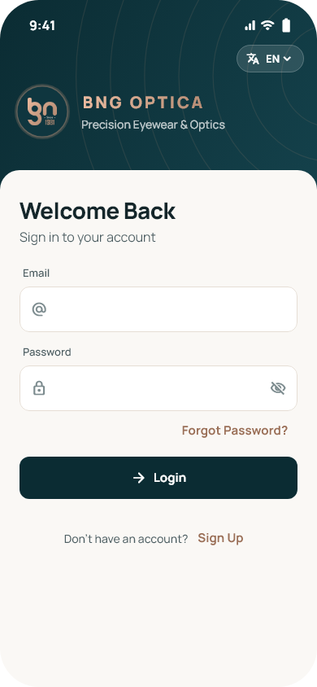
  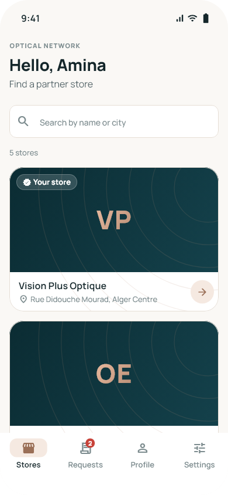
  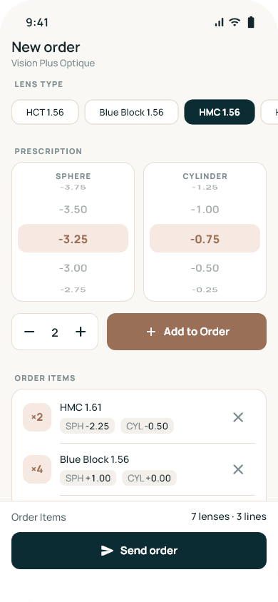
  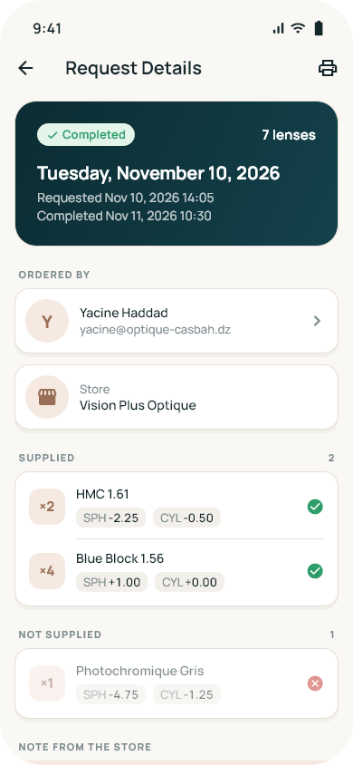
</p>

## Screenshots

| Store directory | Store | Order builder | Inbox |
|:-:|:-:|:-:|:-:|
|  | 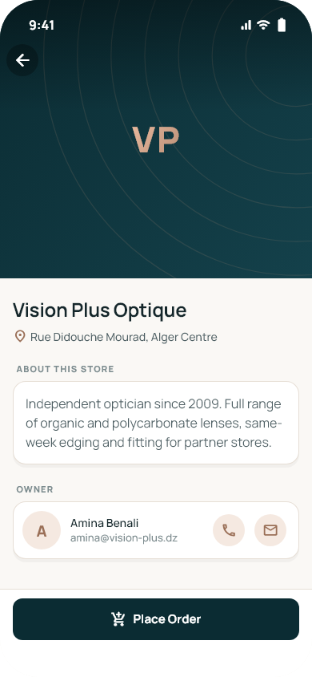 |  | 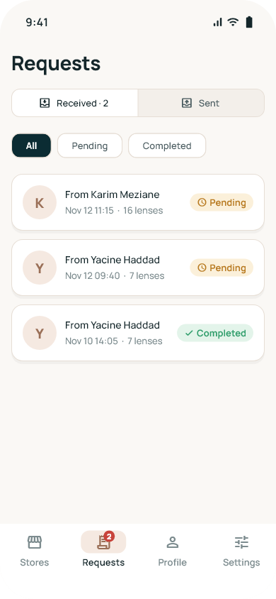 |
| **Request details** | **Process request** | **Thermal ticket** | **Profile** |
|  | 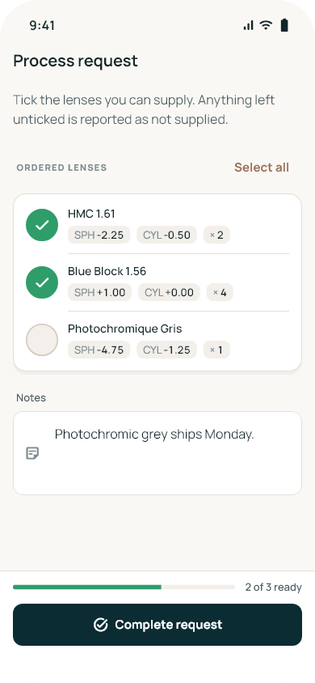 | 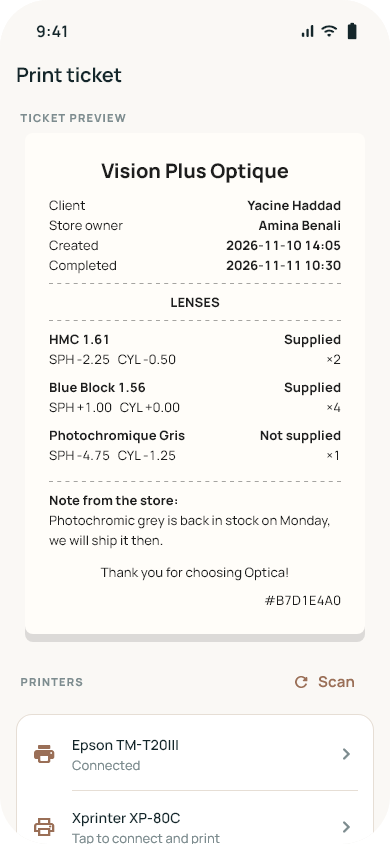 | 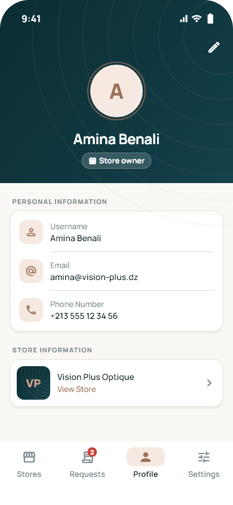 |
| **Settings** | **Dark mode** | **Dark mode** | **Arabic, right-to-left** |
| 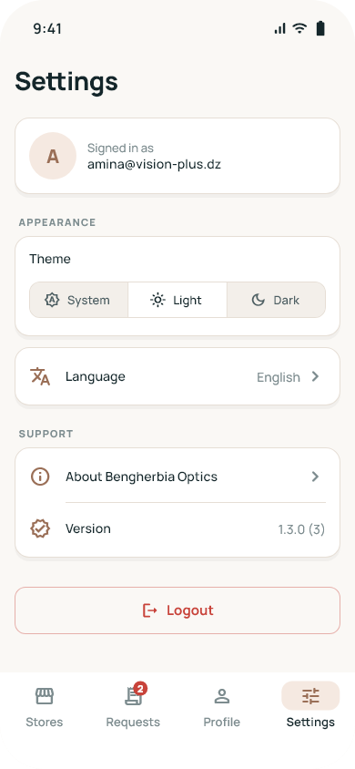 | 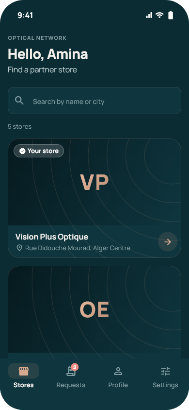 | 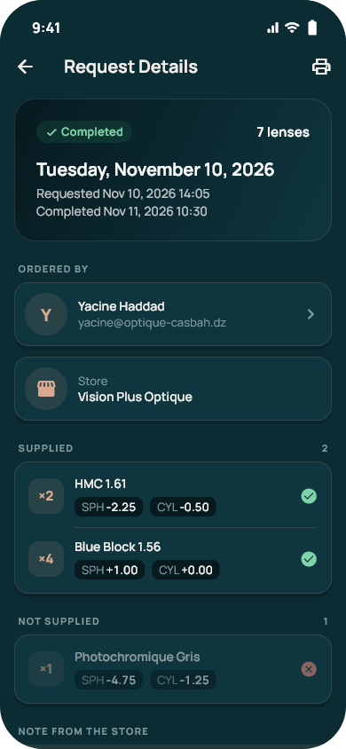 | 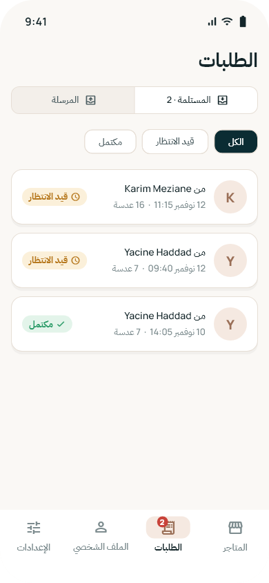 |

The screenshots are rendered by golden tests from fixture data, not captured by hand. `flutter test --tags screenshots --update-goldens` regenerates them, and CI renders them on every push, so they always match the code.

## Features

- **Store directory** with search by name or city, cover photos and a branded fallback when a store has none.
- **Order builder**: lens type chips, sphere and cylinder wheels in 0.25 D steps, quantity stepper. Identical lenses merge into one line. The unsent order is saved per store on the device.
- **Inbox and outbox** with a status filter and a live badge for pending incoming requests.
- **Processing**: the supplying store ticks the lenses it can deliver, adds a note, and completes the request. The client sees supplied and not-supplied lines separately.
- **Thermal printing** over USB or Bluetooth, with an on-screen preview drawn from the same data as the printed ticket.
- **Live alerts** through Supabase Realtime when a request arrives or is completed.
- **Profiles and stores**: edit your profile and photo, open or delete your store.
- **Theme and language** (system, light, dark; four languages), remembered between launches.

## Architecture

Three layers, one direction of flow: `View → Controller → Provider → Supabase`. The full rules are in [AGENTS.md](AGENTS.md).

```
lib/
  core/
    constants/     design tokens (colors, spacing), translation keys, config
    theme/         Material 3 light/dark themes + OpticaPalette extension
    translations/  GetX maps for fr, en, ar, kab
    services/      session, preferences, app info (app-wide state)
    routes/        named routes, pages, auth guards
    utils/         pure logic: validators, order math, ticket model/encoder
  data/
    models/        immutable models: Diopter, LensItem, GlassesRequest, ...
    providers/     the only code that talks to Supabase, Hive or the printer
  presentation/
    modules/       one folder per feature: bindings / controllers / views
    widgets/       shared design system (buttons, cards, states, ...)
    services/      feedback (snackbars, dialogs) and realtime alerts
```

Decisions worth knowing about:

- **Exact prescriptions.** Lens powers are stored as integer quarter-steps (`Diopter`), so `-2.25` is always `-9 × 0.25` and never a floating-point approximation. Equality, merging and formatting are exact.
- **Backward-compatible wire format.** Order lines are still stored as the legacy strings older app versions wrote. `LensItem.encode`/`decode` round-trip them byte for byte, and a line that cannot be parsed is kept verbatim instead of being dropped.
- **No N+1 queries.** Request lists resolve every sender, receiver and store in two batched queries.
- **Providers throw one error type.** `DataException` is the only error that leaves the data layer, so controllers never depend on Supabase exceptions.
- **UI-free controllers.** Controllers show snackbars and dialogs through an injected `FeedbackService`, which tests replace with a recording fake.
- **Design tokens only.** Views read colors from `ColorScheme` and the `OpticaPalette` theme extension, and spacing from a 4/8-point scale. There are no raw hex values or magic numbers in views.

## Quality

| | |
|---|---|
| **Static analysis** | `strict-casts`, `strict-inference` and `strict-raw-types`, plus 20 extra lints. CI fails on any info-level issue. |
| **Tests** | 81 unit, controller and widget tests, plus 14 screenshot renders |
| **Coverage** | about 62% of lines from unit and widget tests (reported on every CI run) |
| **Translations** | A test fails if any key is missing in any language or a `@placeholder` is dropped |

What the tests cover:

- **Models**: serialization round-trips and legacy-row parsing, including the exact wire format of order lines.
- **Order logic**: merging, consolidation, quantity rules, and splitting lines into supplied and not supplied.
- **Controllers**, run against in-memory fakes of every provider: ordering, inbox filtering and batched name lookup, completing a request, deleting and creating a store.
- **Widgets**: form validation messages, the password visibility toggle, adding a lens to an order.

## CI/CD

[`.github/workflows/ci.yml`](.github/workflows/ci.yml) runs on every push and pull request:

1. **Quality**: format check, strict analysis, then tests with a coverage summary on the run page.
2. **Screenshots**: renders every screen and uploads the PNGs as an artifact.
3. **Build**: compiles a release APK and uploads it as an artifact.

[`.github/workflows/release.yml`](.github/workflows/release.yml) publishes a GitHub Release with the APK attached when the version in `pubspec.yaml` changes.

## Getting started

```bash
flutter pub get
flutter run \
  --dart-define=SUPABASE_URL=https://<your-project>.supabase.co \
  --dart-define=SUPABASE_ANON_KEY=<your-anon-key>
```

To use your own backend, create a Supabase project and run [`supabase_schema.sql`](supabase_schema.sql) in its SQL editor. The schema includes the tables, row-level security policies, storage buckets and Realtime setup.

```bash
flutter test --exclude-tags screenshots          # unit, controller and widget tests
flutter test --tags screenshots --update-goldens # re-render docs/screenshots
flutter analyze --fatal-infos
```

## Tech stack

| Layer | Choice |
|---|---|
| UI | Flutter, Material 3, bundled Manrope, IBM Plex Sans Arabic and Noto Sans Tifinagh fonts |
| State and routing | GetX: reactive state, named routes, bindings, route guards |
| Backend | Supabase: Postgres with row-level security, Auth, Storage, Realtime |
| Local storage | Hive (order drafts, preferences) |
| Printing | `flutter_thermal_printer` with ESC/POS |

## License

MIT, see [LICENSE](LICENSE). Bundled fonts are under the SIL Open Font License, see [assets/fonts](assets/fonts).
